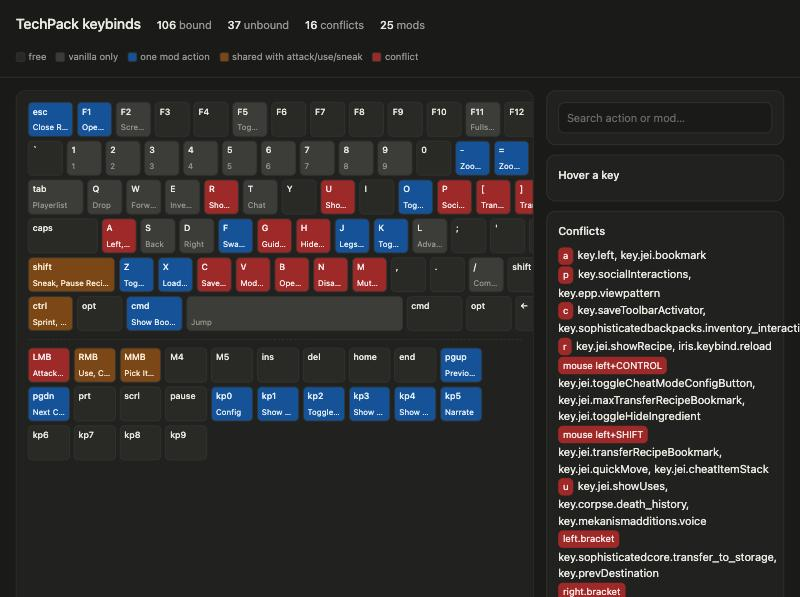

# packloom

**Status: early, in active development. Built for one pack first (a 1.20.1 Forge tech pack, 80 files), where it already builds an mrpack identical to the hand-written script it replaced and brings the server up in 24 s.**

packloom is a set of [Claude Code](https://claude.com/claude-code) skills that turn a Minecraft modpack into plain
text you can edit, build and verify with an agent: a mod list resolved against Modrinth, a server smoke test that
reads the crash log back to the agent, and a keyboard map of every keybind. No launcher of its own: it exports an
`.mrpack` that Prism Launcher imports.

```
mods.txt + pack.json  ──/pack-build──▶  TechPack-1.0.0.mrpack  ──▶  Prism Launcher
        ▲                                      │
        │                               /pack-test (headless Forge server)
        │                                      │
        └────── /pack-triage ◀── smoke-report.json, crash reports ◀──┘
```

## Why

Assembling a modpack is mostly bookkeeping: which versions exist for this game and loader, which libraries they
drag in, which two mods explode together at load time. The bookkeeping is text and the explosions are in logs,
so an agent that can read files and run a server does the loop better than a human clicking through a launcher.
The parts that are taste (what is fun) stay with the human: the skills propose, the human decides.

## What is in the box

| Skill | Does |
|---|---|
| `/pack-init` | creates `pack.json` and an empty `mods.txt` |
| `/pack-add` | searches Modrinth for the pack's game and loader, shows versions and dependencies, adds a line |
| `/pack-build` | resolves `mods.txt`, fetches FTB-maven and direct-URL jars into `overrides/mods`, writes the `.mrpack` and `build-report.md` |
| `/pack-test` | installs the loader server, finds or downloads the right Java (no sudo), starts it headless, writes `smoke-report.json` |
| `/pack-triage` | maps mixin errors, missing dependencies and stack traces to suspect mods, from the server log or the Prism client logs |
| `/pack-keys` | renders an HTML keyboard of every keybind from `options.txt`, grouped by mod and by game stage, conflicts highlighted; `--apply` writes a layout from `keybinds.json` back into the instance |
| `bundle` (CLI) | `dist/<name>-<ver>-client` (mrpack, INSTALL.md, keybinds.html) and `dist/<name>-<ver>-server` (mods, configs, server.properties, `start.sh` that installs the loader on first run), plus zips |



Everything is Python 3.9+ standard library. The skills are thin wrappers around `lib/packloom`, which is also
a CLI: `PYTHONPATH=lib python3 -m packloom --help`.

## The pack format

```
mypack/
  pack.json      { "name": "TechPack", "version": "1.0.0", "minecraft": "1.20.1", "loader": "forge",
                   "loader_version": "recommended", "memory_mb": 6144 }
  mods.txt       one entry per line, comments with #
  overrides/     config/, defaultconfigs/, options.txt, mods/ for jars that are not on Modrinth
```

`mods.txt` lines:

```
thermal-expansion                 # a Modrinth slug: newest stable for the pack's game and loader
mekanism@10.4.16.80               # pinned version
embeddium client                  # keep a rendering mod off the server
ftb:ftb-quests-forge              # FTB maven artifact, shipped in overrides/mods
url:https://example.com/x.jar sha256=…
manual:flux-networks              # CurseForge-only: listed as a manual step in the report
```

Required dependencies come from Modrinth automatically. Full syntax: `lib/packloom/SYNTAX.md`.

## Install

In a project that holds a pack, add to `.claude/settings.json`:

```json
{
  "extraKnownMarketplaces": {
    "packloom": { "source": { "source": "github", "repo": "artem-dovhyi-dev/packloom", "ref": "main" } }
  },
  "enabledPlugins": { "packloom@packloom": true }
}
```

For hacking on the plugin itself: `claude --plugin-dir /path/to/packloom`.

## Keybinds as data

`keybinds.json` next to `pack.json` is optional and holds three things: a `layout` (keybind id → key, applied with
`keys --apply` to the Prism instance and to `overrides/options.txt` so new instances get it), `stages` (always,
in menus, with an item, late game, with friends…) and per-mod or per-key `when` notes. The rendered page lets a
player filter the keyboard by stage, so keys for items they do not own yet stay out of the way.

## Verification loop, honestly

The server test loads the same jars as the client and catches most load-time conflicts: missing dependencies,
version mismatches, mixin failures, duplicate mod ids. It does not exercise rendering, shaders or client-only
mods. For those, launch the instance in Prism and run `/pack-triage --client`, which reads the instance's
`latest.log` and newest crash report.

The suspects in a report are heuristics with evidence attached, not verdicts. A mixin failure inside mod A
is often mod B at the wrong version.

## Roadmap

- quest book generation (FTB Quests SNBT) and an id registry built from the jars, generalised from the first pack
- keybind categories read from the jars' language files instead of guessed from the id
- server deployment to a VPS as a skill (the server bundle and its README already cover the manual path)

Out of scope: generating Java mods, a launcher UI, the CurseForge API.

## Development

```
python3 -m unittest discover -s tests
```

Decisions and open questions live in `.scratch/packloom/` (a wayfinder map: `map.md` plus one file per ticket).

## License

MIT
